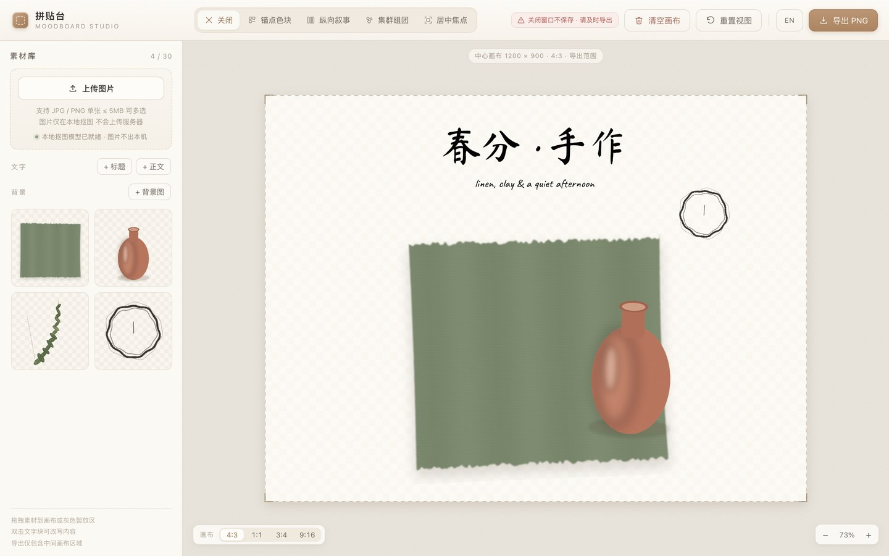
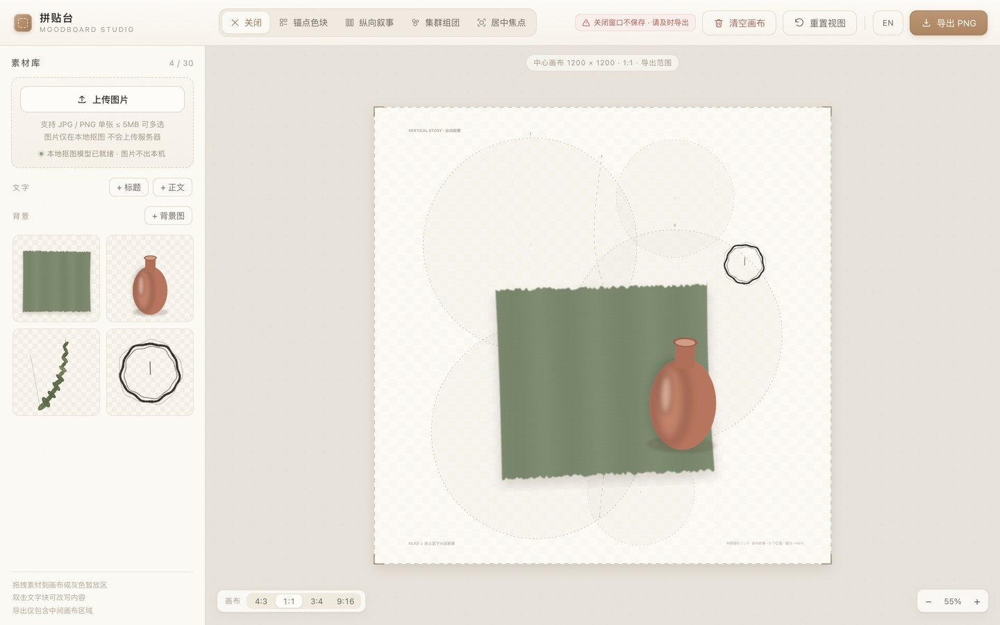
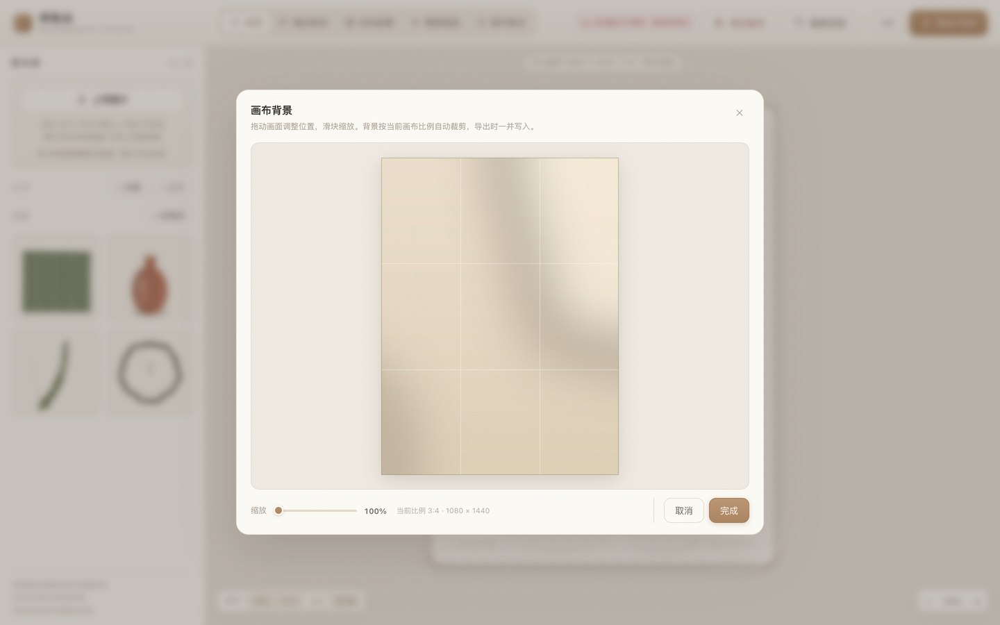
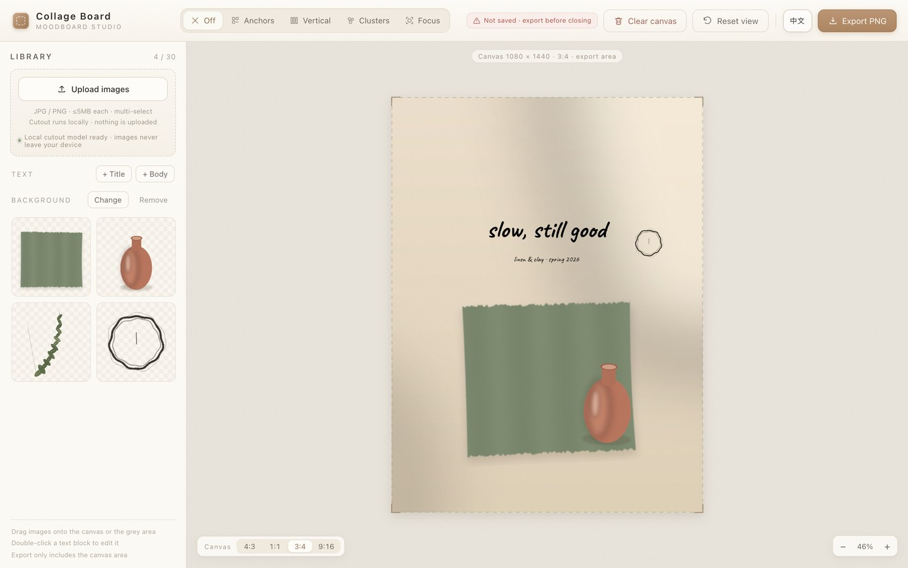

<div align="center">

<a id="zh"></a>

# 拼贴台 · Collage Board

**手作素材的拼贴工作台** — 纯前端，打开即用，图片不出本机

[**在线体验**](https://moodboard-collage.app.workbuddy.host/?sharecode=JNISRK6PRS) · [English](#english)

</div>



## 这是什么

做手作、做内容、做品牌的人手里总有一堆图：布料的纹理、烧出来的陶器、非遗纹样、窗台上那束光。想拼成一张图发给客户或发到社媒，用 PS / Figma 得先跨过图层、蒙版、画布尺寸这些门槛。

拼贴台把这件事压到十几分钟：拖图进来 → 摆位缩放旋转 → 需要时本地抠图 → 导出透明 PNG。不用注册、不用登录、不上传服务器，所有处理都在浏览器里完成。

## 在线体验

**https://moodboard-collage.app.workbuddy.host/?sharecode=JNISRK6PRS**

链接末尾的 `?sharecode=JNISRK6PRS` 是访问凭证，复制时请带上完整一段，只复制域名会返回 403。首次打开会加载 4.5MB 本地抠图模型（页面内有进度条），之后走浏览器缓存。

## 功能

### 画布比例

左下角「画布」四档切换：

| 比例 | 尺寸 | 用途 |
| --- | --- | --- |
| 4:3 | 1200 × 900 | 横版，PPT / 网页配图 |
| 1:1 | 1200 × 1200 | 方形，朋友圈 / Instagram |
| 3:4 | 1080 × 1440 | 小红书竖版 |
| 9:16 | 1080 × 1920 | 全屏竖版，Story / 短视频封面 |

切换时素材**不缩放、不重排**，整体平移让构图保持在画布中央。跑到画布外的素材留在原处继续显示，只是不会被导出——所以换比例不会毁掉已经摆好的版面。

### 构图骨架

四套版式（锚点色块 / 纵向叙事 / 集群组团 / 居中焦点），每套由**一条虚线主轴 + 若干虚线圆**标出图片位置，圆的数量可选 3 / 5 / 8 三档。



骨架坐标是归一化的，运行时按当前比例反解半径，**任意比例下圆的并集都覆盖画布约 54%（留白约 46%）**。骨架只在画布底层预览，不锁定素材、不参与导出。

### 原图 / 自动抠图 / 蒙版修图

选中画布上的图片，底部出现三档：

- **原图**：默认，完整图片；
- **自动抠图**：在浏览器里跑 u2netp（ONNX + WASM，推理进 Worker，不卡界面），图片不出本机；
- **蒙版修图**：画笔擦除 / 恢复，真实笔刷圆圈光标，撤销 / 重做 / 重置，保存后立刻更新画布。

抠图与蒙版**只作用于画布上选中的那一张**，左侧素材库永远保存原图；同一张素材拖入多次，各实例互不影响。

### 自定义背景

左侧「背景」→ 导入图片，在弹窗里拖动画面、滑块缩放，按当前画布比例裁剪（带三分线参考），确认后铺在素材之下并写入导出。



背景记录的是归一化位置而非裁切框，**换比例时会自动重新铺满**，不需要重裁。可随时更换或移除。

### 文字与导出

- 两级文字：手写标题 + 手写正文，纯黑，双击改写；缩放只改字号，不拉伸字形。
- 导出按当前比例输出 PNG，2 倍超采样渲染；无背景时是透明 PNG，有背景时背景一并写入；画布外的素材与所有辅助线都不会被打进图片。

### 中 / 英双语

顶栏 `EN / 中文` 一键切换，首次打开按浏览器语言自动选择，选择存在 localStorage。界面文案、提示、弹窗、画布上的骨架标注全部随之切换。



## 本地运行

浏览器不允许 `file://` 直接加载 ES 模块与本地模型，需要一个静态服务器：

```bash
cd moodboard
python3 -m http.server 8899
# 打开 http://127.0.0.1:8899/index.html
```

macOS 也可以直接双击 `启动.command`（自动起服务并打开浏览器）。

## 目录结构

```
index.html            页面结构
styles.css            米色手作质感样式
js/app.js             素材库 / 上传 / 蒙版弹窗 / 背景裁剪 / 导出流程 / 模型加载
js/editor.js          画布渲染、拖拽缩放旋转、图层、构图骨架、背景绘制、PNG 导出
js/matting.js         本地抠图引擎（u2netp + 兜底边缘分割）
js/i18n.js            中英双语文案（data-i18n 静态标记 + t() 动态文案）
models/u2netp.onnx    本地抠图模型（约 4.5MB）
vendor/               onnxruntime-web WASM 运行时（本地加载，不连 CDN）
fonts/                自带手写字体（Caveat 英文 + 马善政毛笔楷书 中文，OFL 授权）
docs/                 README 截图
```

## 技术说明

- **零后端**：没有接口、没有账号、没有统计，全部逻辑在前端；图片只经 `FileReader` 进内存，关掉页面即消失（顶栏常驻红字提醒及时导出）。
- **本地推理**：`onnxruntime-web` 设 `proxy = true` 把推理放进 Worker，避免主线程阻塞；模型或 WASM 不可用时**静默**切到纯 JS 边缘泛洪抠图，直接进界面，不弹错误窗。
- **字体随包**：英文 Caveat、中文马善政毛笔楷书，均 SIL OFL 授权（`fonts/OFL-*.txt`）。Mac 与 Windows 显示一致，不依赖系统已装字体、不联网；导出前会等 `document.fonts` 就绪再排版，避免按 fallback 字体量错宽度。
- **归一化骨架**：骨架用横版 / 竖版两套归一化布局描述，按目标画布反解圆半径，用二分法逼近 54% 覆盖率。
- **超采样导出**：先在 2 倍尺寸绘制再降采样，边缘更干净。

## 浏览器兼容

需要支持 WebAssembly 的现代浏览器（Chrome / Edge / Safari / Firefox 新版）。不支持 WASM 或模型加载失败时自动进入兼容抠图模式，拼贴与导出不受影响。

## 更新日志

- **2026-11-06** 画布比例 4:3 / 1:1 / 3:4 / 9:16；自定义背景导入与按比例裁剪；中英双语界面；骨架改为归一化布局并适配所有比例。
- **2026-10-26** 自带手写字体（不再依赖系统字体）；抠图作用域改为画布上的单张实例；素材库始终保留原图。
- **2026-10-25** 初版：画布编辑、本地抠图、蒙版修图、构图骨架、透明 PNG 导出。

## 授权

代码可自由参考与二次使用。`fonts/` 内字体遵循 SIL Open Font License 1.1，`vendor/` 内 onnxruntime-web 遵循 MIT，`models/u2netp.onnx` 来自 U²-Net 作者公开权重（Apache-2.0）。

---

<a id="english"></a>

# Collage Board

**A collage workspace for handmade material** — pure front-end, opens in the browser, images never leave your machine.

[**Live demo**](https://moodboard-collage.app.workbuddy.host/?sharecode=JNISRK6PRS) · [中文](#zh)

If you make things by hand — textiles, ceramics, craft patterns, that beam of light on the windowsill — you probably have a folder of photos and no patience for Photoshop. Collage Board turns that into a fifteen-minute job: drop images in, arrange them, cut out what you need, export a transparent PNG.

No sign-up, no upload, no server. Everything runs in the browser.

### Features

- **Canvas ratios** — 4:3 (1200×900), 1:1 (1200×1200), 3:4 (1080×1440), 9:16 (1080×1920). Switching ratio never rescales or rearranges your items; they shift with the canvas centre and anything outside the frame simply stays there and is not exported.
- **Composition guides** — four layouts, each drawn as a dashed axis plus dashed circles marking where images can sit. Pick 3, 5 or 8 slots. Circle coverage stays around 54% of the canvas at every ratio. Guides are preview-only and never exported.
- **Original / Auto cutout / Mask retouch** — auto cutout runs u2netp locally through ONNX + WASM (inference inside a Worker). Mask retouch offers brush erase and restore with a true-size cursor, plus undo, redo and reset. Cutouts apply only to the selected instance on the canvas; the library always keeps the untouched original.
- **Custom background** — import an image, drag and zoom to crop it to the current canvas ratio, and it is composited under your items and included in the export. Positions are stored normalized, so the background re-fills automatically when you change ratio.
- **Text** — two tiers of bundled handwriting fonts (brush-style CJK for Chinese, Caveat for Latin), pure black, double-click to edit. Scaling changes font size only, never stretches glyphs.
- **Export** — PNG at the current canvas size, rendered at 2× and downsampled. Transparent when there is no background. Guides, selection boxes and the gray staging area never appear in the file.
- **Chinese / English UI** — one click in the top bar, auto-detected from the browser on first visit, remembered locally.

### Run locally

```bash
cd moodboard
python3 -m http.server 8899
# open http://127.0.0.1:8899/index.html
```

Opening the file directly with `file://` will not work — browsers block ES modules and local model loading from that scheme.

### Notes

- The 4.5MB matting model loads once and is cached by the browser.
- If WebAssembly is unavailable or the model fails to load, the app silently falls back to a pure-JS edge-flood cutout instead of showing an error.
- Fonts (Caveat, Ma Shan Zheng) are bundled under the SIL Open Font License; `onnxruntime-web` is MIT; the `u2netp` weights come from the public U²-Net release (Apache-2.0).
- Requires a modern browser with WebAssembly support (Chrome, Edge, Safari, Firefox).
